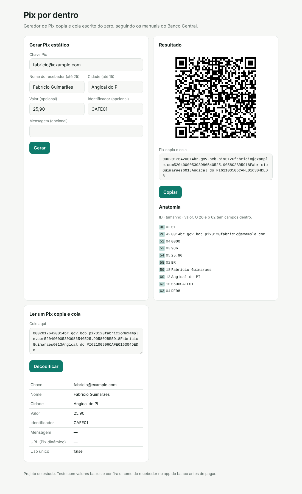

# Pix por dentro — kit de estudo

Kit para implementar do zero, em Python, um gerador de Pix copia e cola (BR Code estático), seguindo os manuais do Banco Central.

Vem com os esqueletos das funções, 60 testes pytest e a especificação explicada. **Todos os testes começam vermelhos.** O objetivo é deixá-los verdes, um arquivo por etapa.



## O que você pratica

- O formato TLV (ID + tamanho + valor) do padrão EMV, usado no BR Code
- O CRC-16/CCITT-FALSE, bit a bit
- Validação de regras de negócio com mensagens de erro claras
- `Decimal` para dinheiro, em vez de `float`
- Uma API simples com FastAPI

## Como começar

1. Leia o `ESPEC_BRCODE.md`: o que tem dentro de um Pix copia e cola, campo a campo.
2. Leia o `GUIA.md`: as etapas, a ordem e os checkpoints.
3. Prepare o ambiente e rode os testes:

Windows (PowerShell):

```powershell
python -m venv .venv
.venv\Scripts\Activate.ps1
pip install -r requirements.txt pytest httpx
pytest
```

Linux ou macOS:

```bash
python -m venv .venv
source .venv/bin/activate
pip install -r requirements.txt pytest httpx
pytest
```

O resultado esperado no início é `58 failed, 2 passed`.

## As etapas

| Etapa | Arquivo | Testes |
|---|---|---|
| 1. CRC16 | `pix/crc.py` | `tests/test_1_crc.py` |
| 2. TLV | `pix/emv.py` | `tests/test_2_emv.py` |
| 3. Payload | `pix/payload.py` | `tests/test_3_payload.py` |
| 4. API | `app/main.py` | `tests/test_4_api.py` |
| 5. Decodificador (bônus) | `pix/decoder.py` | `tests/test_5_decoder.py` |

As regras de cada função estão na docstring dela. Depois da etapa 4, rode `uvicorn app.main:app --reload`, abra http://127.0.0.1:8000, gere um QR com a sua chave Pix e leia no app do seu banco.

## Como saber se está certo

Os testes usam os exemplos oficiais dos manuais do Banco Central. Se o seu código passar, ele gera exatamente o mesmo texto que o Banco Central publica, com os CRCs `1D3D`, `64E4` e `AD38`.

## Créditos

- Kit montado com a ajuda de IA (Claude, da Anthropic).
- Vetores de teste retirados dos manuais do Banco Central.
- Implementação de referência: [pix-por-dentro](https://github.com/fbguimaraes/pix-por-dentro.git)

## Fontes

- [Manual do BR Code — Banco Central](https://www.bcb.gov.br/content/estabilidadefinanceira/spb_docs/ManualBRCode.pdf)
- [Manual de Padrões para Iniciação do Pix — Banco Central](https://www.bcb.gov.br/content/estabilidadefinanceira/pix/Regulamento_Pix/II_ManualdePadroesparaIniciacaodoPix.pdf)

## Licença

MIT
